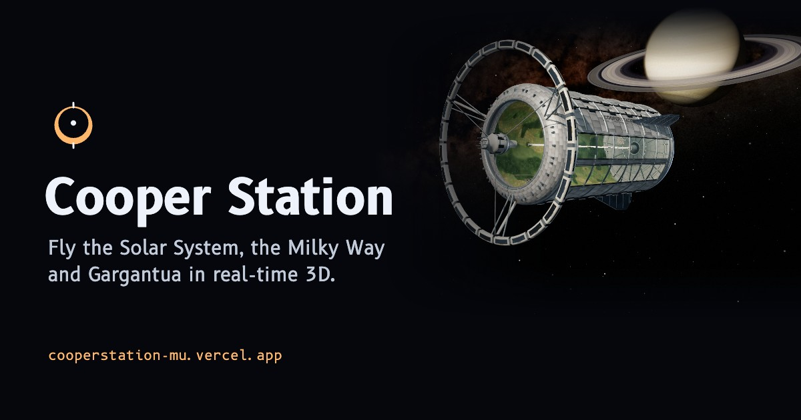

# Cooper Station

A real-time 3D space simulation in the browser. Fly through the Solar System,
look out over the Milky Way, orbit the black hole Gargantua, and go inside
Cooper Station, a rotating cylinder habitat in orbit around Saturn.

Live site: https://cooperstation-mu.vercel.app/



## What you can do

- **Solar System.** The Sun and eight planets sit where they really are today
  and move on their real orbital periods. The clock runs from real time up to
  10 days per second.
- **Planets up close.** See atmospheres, Earth's ocean glint and cloud shadows,
  Saturn's ring shadow, and a churning Sun.
- **Gargantua.** The black hole bends light. Its disk wraps over and under the
  shadow, and the stars behind it slide around as you orbit. A live readout
  shows how much slower time runs at your distance.
- **Milky Way.** A barred spiral with dust lanes, star-forming regions and a
  marker where the Sun is.
- **Cooper Station.** Orbit it, cut it open, fly through the habitat where the
  land curves overhead, and walk the streets of Cooper City. Change the spin
  rate and watch the floor gravity follow.

Every place has a data card with real figures: distance, light time, day,
year, gravity and radius.

## Controls

| Input | Action |
|---|---|
| Drag | Look around |
| Scroll or pinch | Zoom |
| Click a planet or its label | Fly to it |
| `[` `]` | Previous or next planet |
| `W` `A` `S` `D` (or the on-screen stick) | Move inside the station |
| `Shift` | Move faster |
| `Q` `E` | Fly lower or higher |
| `Space` | Pause or resume time |
| `F` | Reset the view |
| `H` | Hide or show the controls |
| `M` | Open the Atlas |

Links like `#earth`, `#blackhole` or `#station/ground` open straight to that
place.

## Running it

Requires Node 20+ and a browser with WebGL 2.

```bash
pnpm install
pnpm dev
```

Then open the URL Vite prints, usually http://localhost:5173.

| Command | What it does |
|---|---|
| `pnpm dev` | Development server |
| `pnpm build` | Production build into `dist/` |
| `pnpm preview` | Serve the production build |
| `pnpm typecheck` | TypeScript check |
| `pnpm test` | Unit tests (Vitest) |

## How it works

Built with [three.js](https://threejs.org/), TypeScript and Vite, with no UI
framework.

| File | Role |
|---|---|
| `src/main.ts` | Page wiring: HUD state, entry, settings |
| `src/flight.ts` | Renderer, camera, lighting and the frame loop |
| `src/input.ts` | Pointer, wheel and keyboard handling |
| `src/hud.ts` | Data card, route rail, labels, hints, thumb stick |
| `src/entry.ts` | Launch sequence that doubles as the loading screen |
| `src/atlas.ts` | Sun, planets, rings and orbits |
| `src/black-hole.ts` | Gargantua's gravitational lens shader |
| `src/deep-space.ts` | Milky Way |
| `src/post.ts` | HDR buffer, bloom and final image pass |
| `src/quality.ts` | Automatic quality levels and frame pacing |
| `src/warmup.ts` | Staged loading and shader warm-up |
| `src/station*.ts`, `src/habitat-*.ts` | The station, its landscape and city |
| `src/physics.ts`, `src/bodies-data.ts` | Physics formulas and planetary data |
| `src/audio.ts` | Synthesized ambient sound |

Some design choices worth knowing:

- **No freezes on view changes.** Everything that decides which shader
  three.js compiles (fog, clipping planes, shadow-casting lights) is fixed for
  the session. All shaders are compiled and drawn once during the launch
  sequence, so moving between places never stalls.
- **Light that actually glows.** The scene is drawn in high dynamic range, and
  bloom comes only from values brighter than white.
- **Automatic quality.** The app drops to a lower level (resolution, bloom,
  shadows, black-hole detail) only when frames are actually being missed, and
  it backs off before trying a higher level again. You can pin a level in
  Settings. The Low level renders the way the original app did.
- **The black hole is ray-marched.** Each pixel's light path is traced around
  a non-rotating (Schwarzschild) black hole, unlike the fast-spinning one in
  the film.

`scripts/bench.js` is a development-only harness that measures frame cost
during a scripted tour; see the comment at the top of the file.

The design and implementation plan for the current version are in
`docs/superpowers/`.

## Credits

- Planet maps by [Solar System Scope](https://www.solarsystemscope.com/textures/),
  [CC BY 4.0](https://creativecommons.org/licenses/by/4.0/).
- Sky map by [NASA/Goddard Space Flight Center Scientific Visualization Studio](https://svs.gsfc.nasa.gov/4851/).
  Gaia DR2: ESA/Gaia/DPAC.
- Planetary data from the [NASA Planetary Fact Sheets](https://nssdc.gsfc.nasa.gov/planetary/factsheet/).
- Typeface: [B612](https://github.com/polarsys/b612), SIL Open Font License.
- Icons: [Tabler Icons](https://tabler.io/icons), MIT.
- Interstellar stills © Paramount Pictures and Warner Bros. Cooper Station is
  an unofficial fan project and is not affiliated with them.
